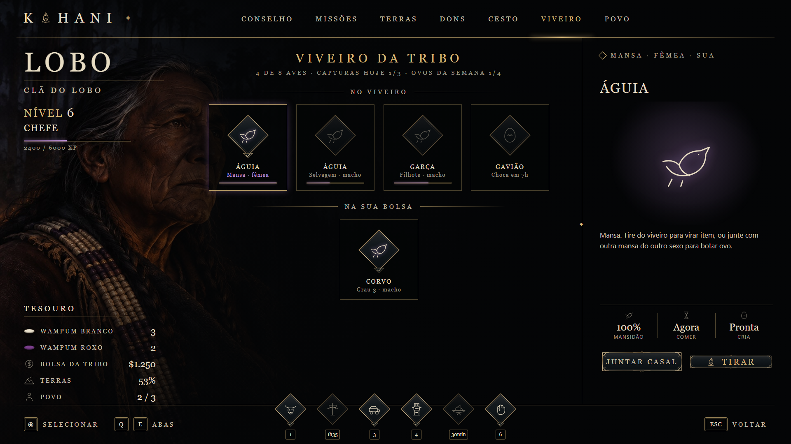

# 04 · Falcoaria

Só **nativo** (membro de tribo) captura, cria e amansa ave. Quando a ave fica pronta, ela vira **item** (`ave_aguia`, `ave_gaviao`...). A partir daí qualquer um usa, dá, troca ou revende: quem não é nativo só consegue ave comprando de um nativo.



## O ciclo

```
ninho (gaiola) ──► viveiro da tribo: SELVAGEM ──alimentar──► MANSA ──tirar──► item ave_<especie>
                                                               │
                         casal (macho + fêmea mansos) ──► OVO ──12 h──► FILHOTE ──alimentar──► MANSA
```

### 1. Viveiro da tribo
- O **chefe** usa o item `viveiro_tribo` a até **40 m da fogueira do conselho**. Cada tribo tem um viveiro; montar de novo muda de lugar.
- No chão aparece um cenário de props do jogo (`Config.Falcoaria.Viveiro.Props`): uma jaula grande, gaiolas, ninho de penas e cocho. Os props são locais, como as fogueiras: aparecem a 120 m.
- Cabem **8 aves** no viveiro (selvagens, mansas, ovos e filhotes).

### 2. Captura no ninho
- Os ninhos ficam em `Config.Falcoaria.Ninhos` (`x, y, z, area, especies`). A lista começa vazia; a staff marca com `/nativos_ninho <área> [especie ...]`.
- Com a `gaiola_falcoeiro` a até 3 m do ninho:
  1. o **servidor** confere se a pessoa é de tribo, se a tribo tem viveiro com lugar, o teto do dia e o descanso do ninho;
  2. sorteia a espécie pelo `peso` e já sorteia se a captura vai dar certo (`chance`);
  3. a ave aparece pousada **só para quem tenta**, e o jogador segura **[E]** por 6 s sem soltar;
  4. se segurou e a sorte deu certo, gasta 1 gaiola e a ave entra **selvagem** no viveiro. Senão, ela voa embora.
- **Domínio da terra:** se a tribo domina pelo menos 50% da área do ninho (`DominioMinimo`), as espécies **raras** (águia, gavião e arara) podem aparecer e a chance sobe 15 pontos.
- **Tetos:** 3 capturas certas por jogador por dia, e o ninho fica vazio 45 min depois de qualquer tentativa.

### 3. Amansar
- Na aba **Viveiro** do painel, o botão **Alimentar** gasta 1 item da comida da espécie.
- Cada refeição soma **+20** de mansidão, e a mesma ave só come de novo depois de 4 h.
- Com 100, a ave fica **mansa**.
- A ave mansa que come tem 25% de chance de soltar a **pena** da espécie.

### 4. Tirar do viveiro (vira item)
- Só ave mansa sai. Quem tira é quem pegou a ave, ou o chefe (`TirarSoDono`).
- O servidor apaga a linha do viveiro **antes** de dar o item (ninguém tira a mesma ave duas vezes); se o item falhar, a linha volta.

### 5. Cria
- **Juntar casal:** a ave mansa escolhida e outra mansa da mesma espécie, do outro sexo e descansada.
- O casal bota um **ovo**, que vira **filhote** em 12 h. O filhote já nasce com 60% de mansidão.
- O casal descansa 48 h, e a tribo tem até **4 ovos por semana**.

### 6. Guardar no viveiro
- Uma ave-item que está na bolsa pode voltar ao viveiro (aba Viveiro, "Na sua bolsa") para formar casal.
- Ela mantém o grau e o apelido; ao ser tirada, volta igual.

### 7. Soltar
- Quem pegou a ave (ou o chefe) pode soltar uma ave selvagem ou um filhote. A ave some de vez.

## Espécies

| Id | Ave | Item | Comida | Pena | Rara |
| --- | --- | --- | --- | --- | --- |
| `aguia` | Águia | `ave_aguia` | `meat`, `game`, `animal_rat` | `eaglef` | sim |
| `gaviao` | Gavião | `ave_gaviao` | `meat`, `bird`, `animal_rat` | `hawkf` | sim |
| `garca` | Garça | `ave_garca` | `fish`, `fishmeat`, `bait` | `kbirdf` | não |
| `pelicano` | Pelicano | `ave_pelicano` | `fish`, `fishmeat` | `pelicanf` | não |
| `corvo` | Corvo | `ave_corvo` | `stringy`, `meat`, `bait` | `ravenf` | não |
| `urubu` | Urubu | `ave_urubu` | `stringy`, `meat` | `pena_ave_selvagem` | não |
| `arara` | Arara-vermelha | `ave_arara` | `bait` | `bparrotf` | sim |

Os itens de comida e de pena já existem no banco do servidor. O `nome` de cada espécie precisa ser **igual** ao do catálogo do recurso de aves (`Config.Birds`), porque é por ele que o jogo acha o modelo da ave.

## A ave como item (`Seveskaya_birds`)

O recurso de aves continua sendo o **corpo da ave**: voar, seguir, assobio, adestrar, grau e plumagem. Mudou só o servidor ([`codigo/Seveskaya_birds/server.lua`](codigo/Seveskaya_birds/server.lua)), mais o config e 3 linhas do cliente:

- **O dono é quem carrega o item.** Cada item `ave_*` tem `metadata.aveId`, que aponta para a linha da ave em `seveskaya_birds`. Ali ficam grau, XP, apelido, plumagem e sexo.
- **Usar o item chama a ave** (evento `dodi_birds:spawnBird`).
- **O `/aves` lista as aves-item que a pessoa carrega.** Ali ela adestra, dá apelido, troca a plumagem, vende ou solta.
- **Vender a outro jogador** pelo menu do `/aves`: o item sai do vendedor e entra no comprador; só depois o dinheiro passa. Também dá para simplesmente dar o item.
- **Botica fechada** (`Config.BoticaAberta = false`): a vitrine fica vazia e a compra é recusada no servidor.
- **Aves antigas:** a ave comprada antes da mudança vira item sozinha na primeira vez que o dono abre o `/aves`, se couber na bolsa (coluna `item_dado`).
- **Descrição do item:** mostra apelido, grau e sexo, e se atualiza quando a ave sobe de grau ou ganha apelido.

### Exports do recurso de aves (usados pela falcoaria)

```lua
local aves = exports.Seveskaya_birds  -- nome da pasta: Config.Falcoaria.RecursoAves
aves:CriarAveItem(src, { nome, categoria, item, sexo, origem })  --> aveId ou nil (sem lugar na bolsa)
aves:RecolherAveItem(src, itemId)    --> { aveId, nome, sexo, apelido } ou nil (tira o item da bolsa)
aves:DevolverAveItem(src, aveId)     --> true/false (entrega o item de uma ave que já existe)
aves:AvesNoInventario(src)           --> { { itemId, aveId, nome, apelido, grau, sexo }, ... }
aves:SoltarAve(aveId)                --> apaga a ave do banco
```

## Itens novos (`nativos_itens.sql`)

`gaiola_falcoeiro`, `viveiro_tribo`, `ave_aguia`, `ave_gaviao`, `ave_garca`, `ave_pelicano`, `ave_corvo`, `ave_urubu` e `ave_arara`.

## Tabelas

```sql
nativos_viveiros       (gang_id, x, y, z, heading)
nativos_viveiro_aves   (id, gang_id, especie, sexo, estado, mansidao, ultima_comida, pronto_em,
                        descanso_ate, dono_identifier, dono_charid, ave_id, origem)
                        -- estado: selvagem | manso | ovo | filhote
                        -- ave_id: a ave do recurso de aves, quando ela foi guardada (volta igual)
nativos_falcoaria_log  (gang_id, identifier, charid, acao, especie, criado_em)
                        -- acao: captura | tirar | guardar | ovo | soltar | viveiro (é daqui que saem os tetos)
seveskaya_birds        + sexo, origem, item_dado
```

O ovo vira filhote "sozinho": toda vez que o viveiro é lido, os ovos com `pronto_em` vencido passam a filhote. Não há timer rodando.

## Eventos

| Evento | Direção | Uso |
| --- | --- | --- |
| `pantanal_nativos:falcoaria:pedirDados` | painel → servidor | dados da aba Viveiro |
| `pantanal_nativos:falcoaria:dados` | servidor → cliente | resposta, repassada ao painel como `updateViveiro` |
| `pantanal_nativos:falcoaria:alimentar` / `tirar` / `guardar` / `casal` / `soltar` | painel → servidor | ações (id da ave, ou do item para guardar) |
| `pantanal_nativos:falcoaria:viveiros` | servidor → todos | onde estão os viveiros (para os props) |
| `pantanal_nativos:falcoaria:capturar` / `fimCaptura` / `resultado` | servidor ↔ cliente | captura no ninho |

## Ainda a decidir

- O cenário do viveiro usa props do jogo. O dono citou o cenário da **rinha de galo** como modelo, mas esse recurso não foi achado no disco. Quando ele aparecer, o viveiro pode ganhar um prop nosso.
- Vender aos anciões por Wampum (ave rara, penas) fica para depois. Hoje a venda é só entre jogadores, por dinheiro.
