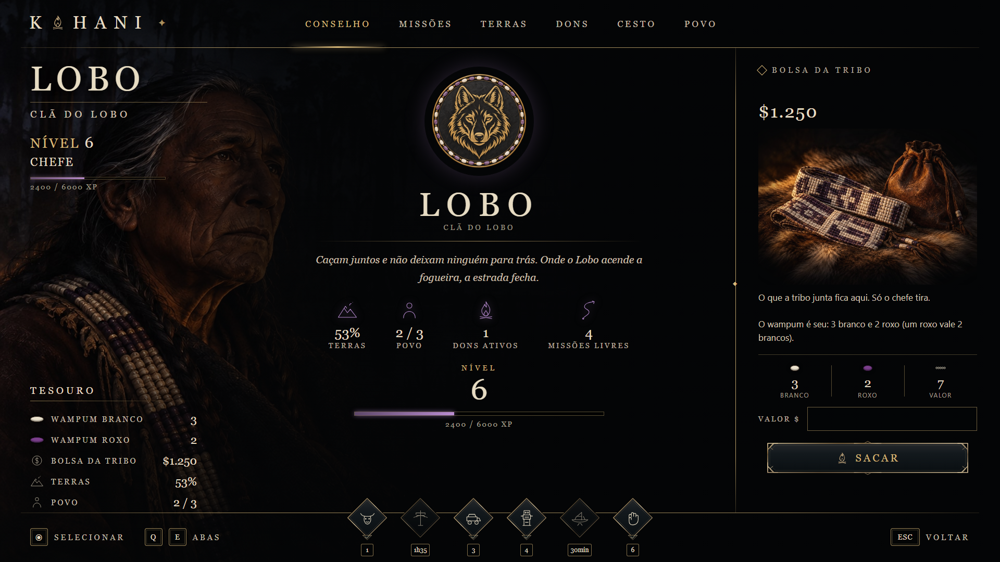

# Sevskaya Nativo

Sistema dos **nativos** (a confederação Kohani) do servidor Pantanal RP, em RedM com VORP.

Os nativos se organizam em **tribos**. Cada tribo domina a terra acendendo uma **fogueira ritual** nos pontos sagrados, faz missões, acende dons, guarda itens no cesto e paga com a própria moeda, o **Wampum** (contas brancas e roxas). Só os nativos capturam, criam e amansam aves (a **falcoaria**). A ave pronta vira item, e aí qualquer um pode comprar.

O painel do jogo (`/tribo`) tem a mesma tela do grimório do [Sistema Sobrenatural](https://github.com/sevskaya/sistema-sobrenatural).



## Estado (19/10/2026)

O código está escrito, mas **nada foi testado no jogo ainda**. As pendências estão no [PLANO.md](PLANO.md).

| Parte | Situação |
| --- | --- |
| Domínio por fogueira ritual | escrito |
| Wampum branco e roxo | escrito |
| Painel `/tribo` igual ao grimório (7 abas) | escrito e visto no navegador com dados de teste |
| Falcoaria (ninho, viveiro, amansar, cria, ave como item) | escrito |
| Missões próprias dos nativos | **por decidir** (hoje ainda são as da máfia) |
| Lista de tribos, pontos sagrados e ninhos | **por fazer** |

## Documentos

| Arquivo | O que explica |
| --- | --- |
| [01-lore.md](01-lore.md) | quem são os Kohani, o Wampum, a fogueira e a falcoaria na história |
| [02-dominacao.md](02-dominacao.md) | tribos, fogueira ritual, pontos sagrados, conselho, dons, cesto, povo, comandos e tabelas |
| [03-wampum.md](03-wampum.md) | a moeda: saldo, preço, troco, trocas, recompensas e exports |
| [04-falcoaria.md](04-falcoaria.md) | captura nos ninhos, viveiro, amansar, cria e a ave como item |
| [05-painel.md](05-painel.md) | a tela do `/tribo`: estrutura, abas, mensagens do jogo, imagens e o demo |
| [06-imagens.md](06-imagens.md) | as artes que faltam, com nome, tamanho e o que mostram |
| [07-instalar-e-testar.md](07-instalar-e-testar.md) | instalação, banco e o roteiro de teste no jogo |
| [08-passagem-para-o-dev.md](08-passagem-para-o-dev.md) | onde está cada coisa, regras que não se quebram e como acrescentar |
| [PLANO.md](PLANO.md) | decisões do dono e o que falta |

## O que está neste repositório

Este repositório é **público**, então traz só o que é **nosso**: a documentação e o código que escrevemos. O sistema de gangues em que a tribo se apoia é um recurso pago (Dodiban, *gang system* para RedM), assim como a base do recurso de aves. Esse código fica só no servidor e **não** está aqui.

```
codigo/
  pantanal_nativos/
    server_wampum.lua          moeda Wampum (inteiro, nosso)
    config_falcoaria.lua       falcoaria: espécies, ninhos, viveiro, tetos
    server_falcoaria.lua       falcoaria: servidor
    client_falcoaria.lua       falcoaria: cenário do viveiro e captura no ninho
    config_trechos_nossos.lua  as partes nossas do config.lua (fogueira, Wampum, tribos)
    ui_trechos_nossos.lua      as partes nossas do ui.lua (ponte do painel novo)
    nativos_itens.sql          itens novos no banco
    html/                      o painel inteiro (index, tribo.css, tribo.js, simbolos.js, imagens)
  Seveskaya_birds/
    server.lua                 o servidor das aves (nosso: a ave como item, Botica fechada, exports)
imagens/                       capturas do painel
```

O resto do `pantanal_nativos` (domínio, missões, dons, cesto, membros) é o recurso base com os nomes trocados: tabelas `nativos_*`, eventos `pantanal_nativos:*`, textos de tribo. Como ele foi adaptado está explicado no [02-dominacao.md](02-dominacao.md).
